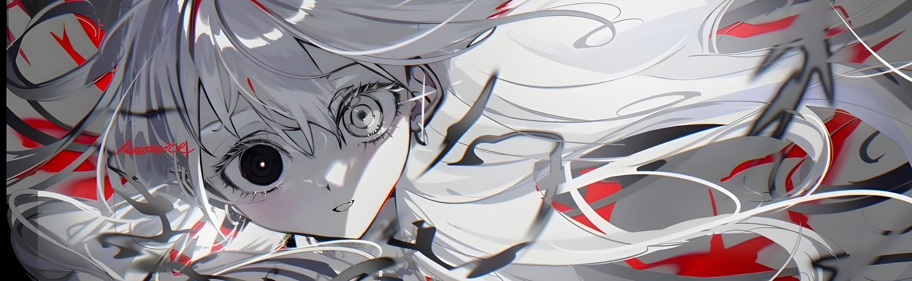

  

  

  

 

### about

I build fast, reliable cross-platform applications and web services — from interface design to server-side logic. Clean architecture and clean code come first.

- desktop apps with **Tauri** and **Rust**, native speed without the bloat
- responsive web apps on **React**, **Vue** and **Next.js**
- APIs with **Node.js / Express** and **Rust**, backed by **MongoDB**

 

### stack

 

### stats

  
  

  

 

  <picture>
    <source media="(prefers-color-scheme: dark)" srcset="https://raw.githubusercontent.com/saykachi/saykachi/output/snake-dark.svg" />
    <source media="(prefers-color-scheme: light)" srcset="https://raw.githubusercontent.com/saykachi/saykachi/output/snake-light.svg" />
    
  </picture>

open to new projects — feel free to reach out.

